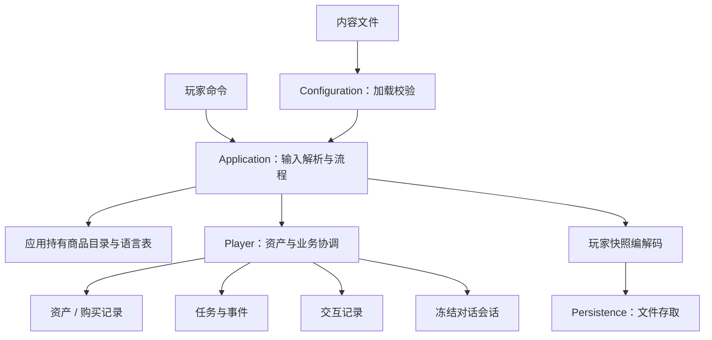

# 新手村：可交互应用层

这是实际可运行、可自由输入命令的应用，不是把测试打印出来。它组合现有配置、资产、商城、任务、交互、对话和存档模块。当前是本地命令行参考游戏，没有图形界面、战斗或联网服务。

## 构建与启动

从工程根目录执行：

```sh
cmake -S . -B build -DCMAKE_BUILD_TYPE=Debug
cmake --build build --target designer_game --parallel
./build/bin/designer_game
```

默认读取本应用 `content/`，存档为当前工作目录下 `saves/player.sav`。已有文件自动恢复，不存在则创建内存中的新玩家；实际写盘要输入 `save`。默认内容路径在构建时指向源码，移动程序时显式提供 `--content`。

不同体验使用不同存档路径，无须手动修改或删除旧存档：

```sh
./build/bin/designer_game --save saves/another-player.sav
./build/bin/designer_game --content apps/console/content --save saves/player.sav
```

在 VS Code 可以直接使用集成终端。CMake 默认启用 `DESIGNER_BUILD_APPS`；作为子项目嵌入时默认关闭。只想构建应用可以关闭示例与测试，应用不依赖它们。

## 全流程体验

新玩家固定 5 级、500 金币、16 格背包。这是参考游戏的启动策略，不是通用 Player 默认值。

在首次启动的新存档中，依次输入：

```text
status
shop
buy 100 1
quests
accept 1
inspect 7
talk 5001
next
choose 20
finish
quests
claim 1
status
save
quit
```

预期：购买后400金币、5药水；调查路标和完成对话分别推进两个任务目标；领奖后500金币、1积分、7药水，任务已领奖。再次启动相同路径自动恢复。

也可以先到 `next`，进入选项节点时输入 `save`、`quit`；重启输入 `dialogue`，再 `choose 20`、`finish`、`claim 1`，会从旧会话继续。

## 命令

| 命令 | 用途 |
| --- | --- |
| `help` | 显示命令与建议流程 |
| `status` | 等级、余额、非空背包格、是否有未保存进度 |
| `shop` | 商品、每份成本与奖励 |
| `buy <商品ID> <份数>` | 借用应用持有的商品表购买 |
| `quests` | 任务状态与当前目标进度 |
| `accept <任务ID>` | 使用可信等级和当前事件边界接取 |
| `inspect <交互点ID>` | 执行检查交互并联合投递任务事实 |
| `talk <对话ID>` | 开始一个对话，本应用一次展示一个活动会话 |
| `dialogue` | 读取当前会话的文本与选项 |
| `next` / `choose <选项ID>` | 推进文本 / 选择分支 |
| `finish` | 在结束节点确认完成并投递事实 |
| `cancel` | 取消对话，不产生完成事实 |
| `claim <任务ID>` | 发奖与领取标记统一提交 |
| `save` / `load` | 保存 / 用指定存档替换当前内存状态 |
| `quit` | 退出，不自动保存 |

可以尝试资金不足、重复调查一次性交互、未完成就领奖、重复领奖、错误选项等情况。交互模式会显示错误并允许继续，不退出应用。`load` 会放弃未保存的内存变化；这不是把物品追加进背包。

## 应用层与领域层的分工



- [main.cpp](main.cpp)：启动参数、终端或脚本输入、顶层失败退出。
- [application.hpp](application.hpp) / [application.cpp](application.cpp)：内容装配、只读显示、调用业务接口、请求 ID 与保存生命周期。
- [content/game.json](content/game.json)：物品、货币、商品、任务和路标交互。
- [content/5001.json](content/5001.json)、[content/zh-CN.json](content/zh-CN.json)：对话图和正文。

Book、交易和状态机仍由领域模块维护。应用不直接修改claimed、余额或进度，不通过模拟目标事件跳过交互和对话。显示用物品名称、目标说明和初始等级是本参考游戏的简小映射，不是通用内容编辑器。

## 保存与失败边界

保存显式创建父目录，随后复用 `save_atomic`。已替换但目录同步失败时显示“持久性未确认”，保持未保存标记。内存业务成功不等于已经写盘，保存失败可重试保存，不重新领奖。

存在的存档损坏或与当前规则不兼容时，启动退出并保留文件，不悄悄开新档覆盖。恢复后从全部成功历史及会话 ID 计算新的请求 ID，避免重启后把新命令误认为旧命令。当前没有网络超时重试入口、跨进程写入、账号、云存档或数据库持久性。

退出不自动保存；输入结束也会退出，未保存时明确提示。初始等级固定5级，没有实现成长/升级系统；加载旧状态也使用这个参考游戏的等级策略。

## 无需手动输入的演示

```sh
./build/bin/designer_game --save build/first-demo.sav --script apps/console/walkthrough.txt
```

对一个不存在的路径运行全流程脚本；同一路径再次运行会先恢复已完成状态，脚本重新接任务会被正常拒绝。想重演请用新的存档路径。脚本与交互模式走相同业务代码，脚本遇错返回非零，适合验证集成。

实际验证与取舍见 [开发记录](development/001-playable-application.md)。

## 当前内容所有权

Application通过content_持有商品和交互目录，通过dialogue_catalog_持有对话图目录，通过texts_持有正文。调用Player时分别传入const引用，Player只保存运行Book及冻结会话，不保存当前商品/交互/对话Catalog。变更见[应用步骤002](development/002-own-content-catalogs.md)。
