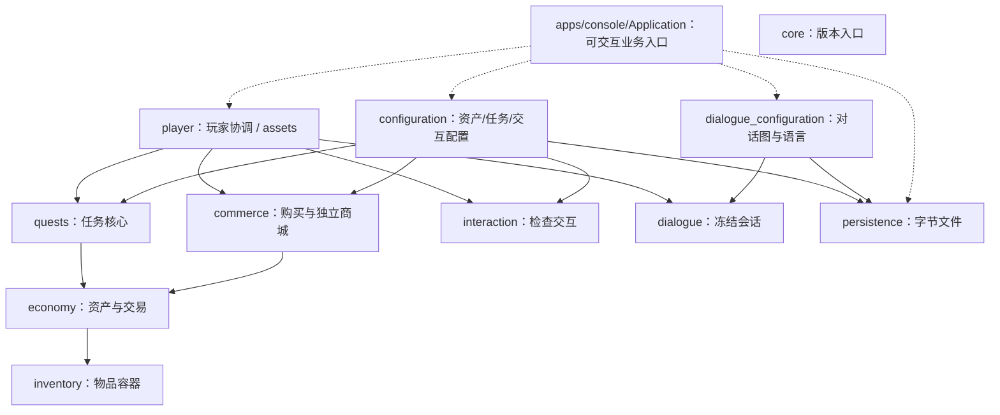
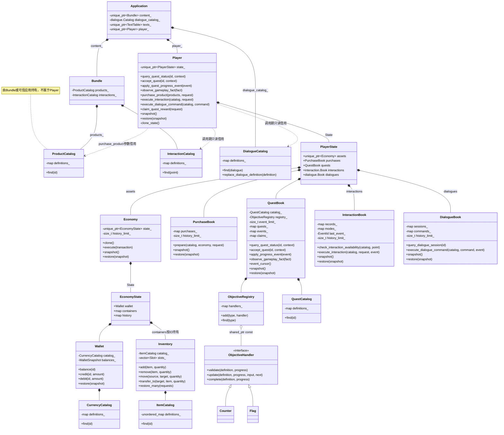
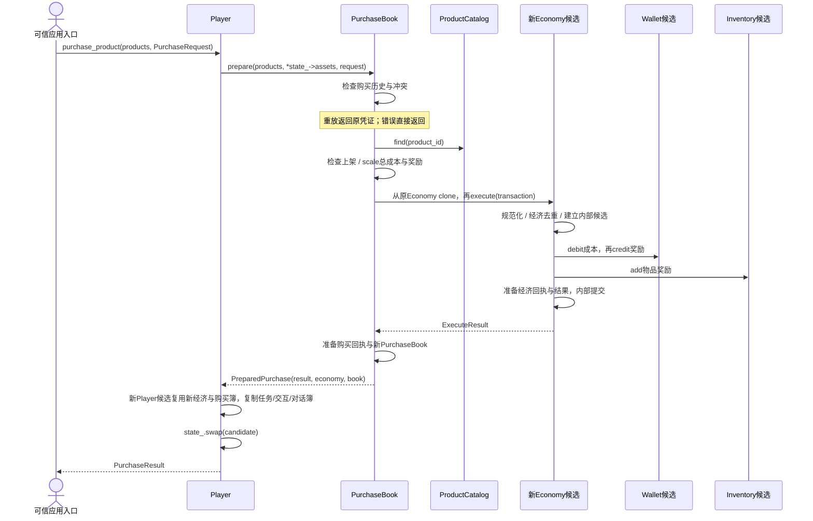
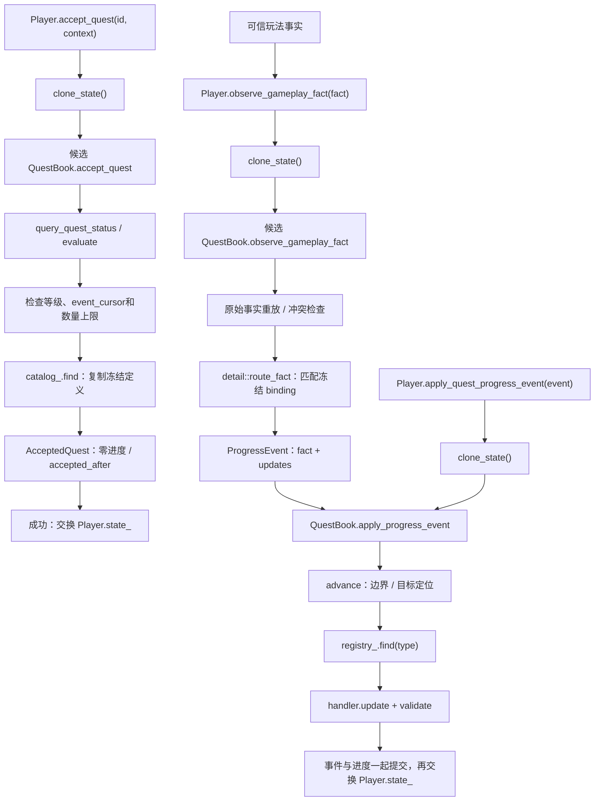
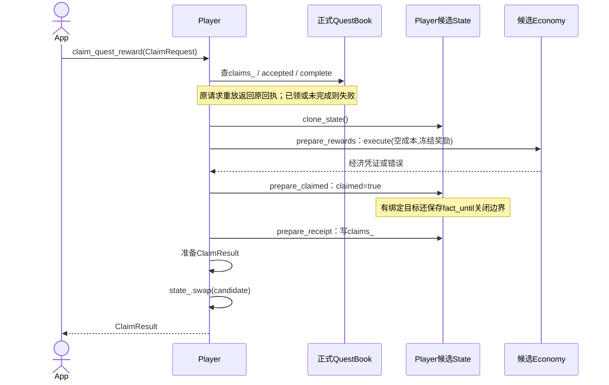
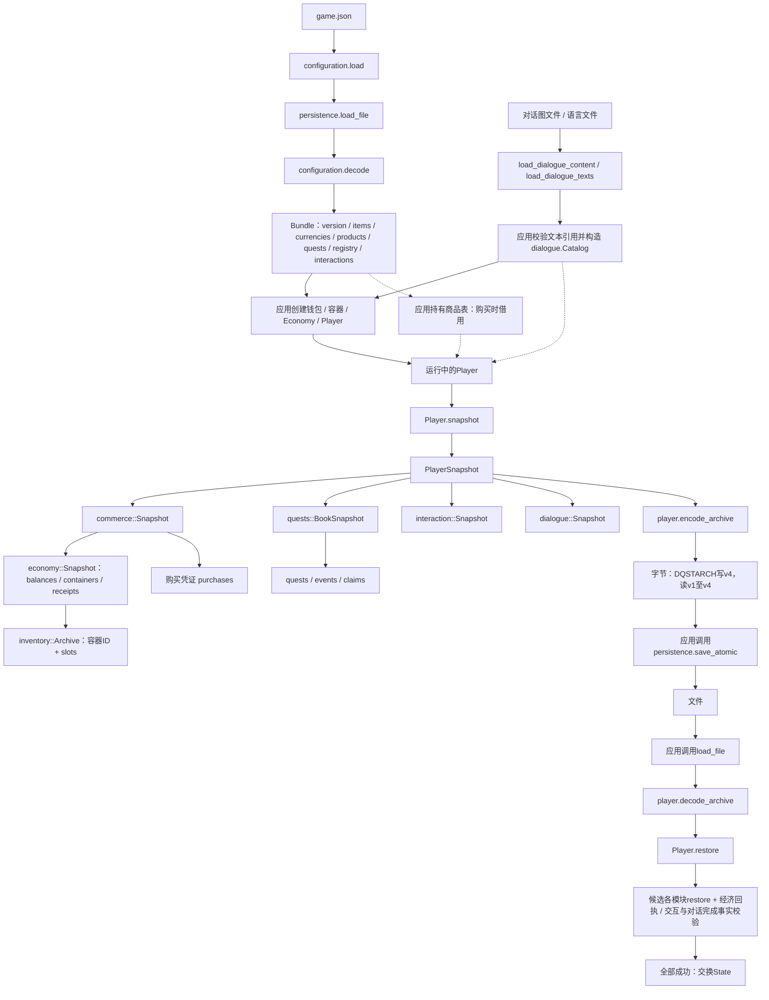
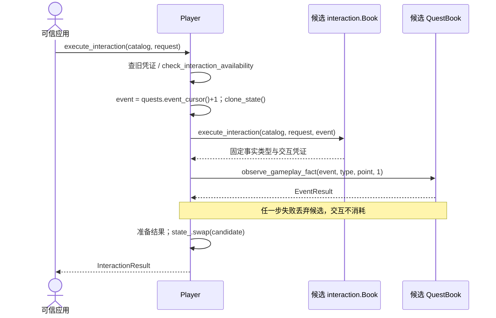
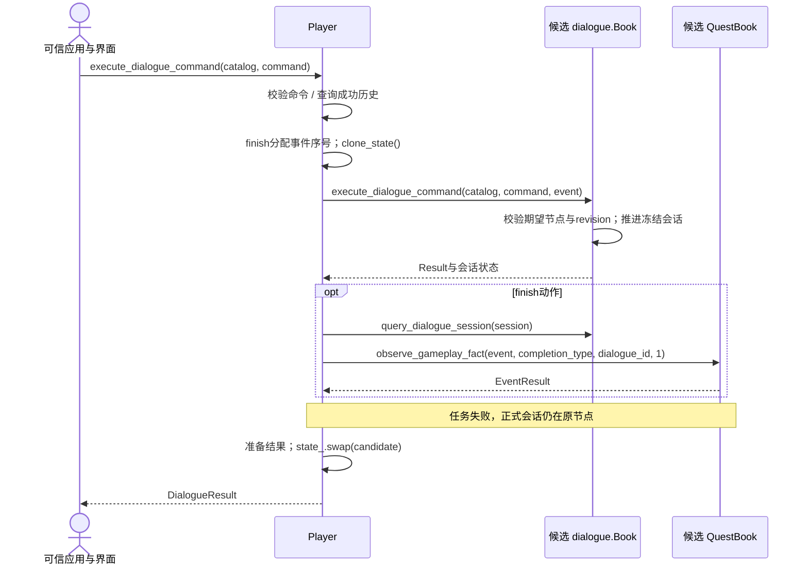

# 当前系统详细架构：成员、规则与函数交互

日期：2026-10-24。依据：当前头文件、Player/Commerce/Quests 实现及 CMake。本文是代码导读，不是未来类设计；没有实现的模块不虚构成员或接口。本版按玩家步骤006/007/008同步：商品目录外置、State::assets、交互/对话目录与Book、完整玩家存档v4。

阅读顺序：所有权 → 模块规则表 → 跨模块函数表 → 购买/任务/领奖流程 → 配置与存档。

## 零、模块依赖总图

实线表示源码/构建依赖，虚线表示应用使用；独立模块不等于独立网络服务。商品配置由应用持有，在购买调用时借用。Core没有强制通往各领域的依赖。

## 一、所有权总览

`*--` 表示按值或 unique_ptr 拥有，`o--` 表示共享不可变处理器。箭头不是网络连接，也不意味着单独服务。

图中 PlayerState/EconomyState 是为了区分两个嵌套 `State` 而使用的显示名，并非真实顶层类型名。候选状态是以上结构的临时副本，不是永久第二套权威资产。Slot 为 optional<ItemStack>；不保存第二份格数。正式 State 替换后旧查询视图可能失效。

独立 Shop 是另一种装配入口：`Shop{catalog_, state_, history_limit_}`，其 State 拥有 `unique_ptr<Economy> economy` 与 `PurchaseBook purchases`。Player **不拥有 Shop**，只复用 PurchaseBook；独立 Shop 与 Player 不会自动同步。

## 二、模块规则、成员和接口

| 模块/类 | 实际持有的数据 | 保护的规则 | 主要对外交互 |
| --- | --- | --- | --- |
| inventory / ItemCatalog | definitions_: unordered_map<ItemId, ItemDefinition> | ID/上限正数，ID 不重复 | 构造规则，find(id) |
| inventory / Inventory | catalog_: ItemCatalog；slots_: vector<Slot> | 非空堆合法；无零数量堆；整体成功；移动/转移守恒 | add/remove/move/swap_slots/transfer_to/transfer_all_to/snapshot/restore/restore_many |
| economy / CurrencyCatalog | definitions_: map<CurrencyId, CurrencyDefinition> | 有效货币及余额上限 | find(id) |
| economy / Wallet | catalog_；balances_: map<CurrencyId, Amount> | 无负余额、无零余额记录、不超上限 | balance/definition/credit/debit/snapshot/restore |
| economy / Economy | state_ → wallet/containers/history；history_limit_ | 成本/奖励/经济记录一起成功；请求幂等与冲突；先付成本 | clone/execute/wallet/container/history_size/snapshot/restore |
| commerce / ProductCatalog | definitions_: map<ProductId, ProductDefinition> | 单份成本奖励有效，商品身份/版本合法 | find/entries/swap |
| commerce / PurchaseBook | purchases_: map<RequestId, PurchaseReceipt>；history_limit_ | 购买意图绑定经济回执，重试早于当前商品检查 | prepare/snapshot/restore；不拥有资产 |
| commerce / Shop | catalog_；state_ → economy/purchases；history_limit_ | 独立商城的购买与经济状态一致 | purchase/replace_catalog/snapshot/restore |
| quests / QuestCatalog | definitions_: map<QuestId, QuestDefinition> | 配置有效且标准化，目标ID唯一、奖励无重复 | find/entries/swap |
| quests / ObjectiveRegistry | handlers_: map<TypeId, shared_ptr<const ObjectiveHandler>> | 类型唯一，处理器非空且确定无副作用 | add/find；default_objectives装配默认处理器 |
| quests / QuestBook | catalog_/registry_/event_limit_/quests_/events_/claims_ | 冻结定义；接取/领奖边界；事件顺序去重；单调进度；领奖记录一致 | query_quest_status/accept_quest/apply_progress_event/observe_gameplay_fact/accepted/event_cursor/replace_catalog/snapshot/restore |
| player / Player | state_ → assets/purchases/quests/interactions/dialogues | 同一玩家唯一资产；发奖/领取标记/凭证统一提交 | query_quest_status/accept_quest/apply_quest_progress_event/observe_gameplay_fact/purchase_product/claim_quest_reward/execute_interaction/execute_dialogue_command/replace_quests/snapshot/restore |
| configuration / Bundle | version_/items_/currencies_/products_/quests_/registry_/interactions_ | 完整校验后只读交付，不返回半包 | load/decode + Bundle只读查询；不自动修改Player |
| persistence | 无常驻领域对象；调用期间临时文件句柄和字节 | 有界读取；失败不污染输出；同目录原子替换及提交状态区分 | load_file/save_atomic |
| interaction / Catalog、Book | Catalog.definitions_；Book.records_/modes_/last_event_/history_limit_ | 一次性/可重复交互、请求重放、配置模式一致、成功事实序号 | check_interaction_availability/execute_interaction/find_interaction_receipt/snapshot/restore |
| dialogue / Catalog、Book | Catalog.definitions_为共享不可变图；Book.sessions_/commands_/history_limit_ | 冻结会话图、期望节点/修订号校验、命令去重、完成和取消区分 | execute_dialogue_command/query_dialogue_session/find_dialogue_receipt/snapshot/restore |
| dialogue_configuration | 独立加载结果DialogueContent、TextTable | 单图文件与语言文本分离；发布前文本键完整 | load_dialogue_content/load_dialogue_texts/validate_dialogue_text_references |
| core | 无业务状态 | 当前仅版本查询 | core::version |
| tests | 独立测试程序，不是领域所有者 | 检验规则和故障路径，不改变发布接口 | CTest、示例save/load测试 |

map 的键和值以各公开头文件为准；表中省略了命名空间前缀。资源、战斗、装备、AI、邮件、账号、网络等待开发模块没有真实成员或交互函数，不能从 README 规划推断出接口。

## 三、跨模块实际函数调用

| 调用方 | 调用目标 | 数据/目的 | 是否改变输入正式状态 |
| --- | --- | --- | --- |
| configuration::load | persistence::load_file | 配置字节、有界读取 | 不改玩家 |
| configuration::decode | 各Catalog构造/find、ObjectiveHandler::validate | 建立目录、检查引用与处理器 | 仅构造局部目录 |
| 应用层 | Bundle各getter、Player构造 | 复制目录，装配单份经济对象 | 创建新玩家 |
| Player::query_quest_status | QuestBook::query_quest_status | 状态与条件查询 | 否 |
| Player::accept_quest / apply_quest_progress_event / observe_gameplay_fact | 候选QuestBook对应方法（apply_quest_progress_event转发apply_progress_event） | 接取、直接更新或事实路由 | 外层swap前不改正式Player |
| Player::purchase_product / Shop::purchase | PurchaseBook::prepare | 调用方商品表、经济只读引用、购买请求 | prepare不改传入经济和购买簿 |
| PurchaseBook::prepare | ProductCatalog::find；Economy::clone/execute | 查询价格、缩放、候选结算 | 改新经济候选 |
| Economy::execute | 候选Wallet::debit/credit；Inventory::add | 扣成本，发货币和物品 | 改经济候选，最后本层swap |
| QuestBook::accept_quest | query_quest_status/evaluate；QuestCatalog::find | 条件检查、复制冻结定义 | 成功加入已接任务 |
| QuestBook::observe_gameplay_fact | detail::route_fact，再apply_progress_event | 原始事实→冻结目标的更新集合 | 候选进度与事件共同提交 |
| QuestBook进度推进辅助 | ObjectiveRegistry::find；handler::update/validate | 计算并验证next | 验证后才改进度 |
| QuestBook::complete | handler::complete | 所有目标完成判定 | 否 |
| Player::claim_quest_reward | QuestBook::accepted/complete，三个prepare函数 | 资格检查与候选领奖 | 外层swap前不改正式Player |
| Player::prepare_rewards | 候选Economy::execute | 冻结奖励，空成本 | 改候选资产，产生经济回执 |
| Player::prepare_claimed | 通过friend访问候选QuestBook | claimed=true，绑定任务记录fact_until | 不调用外部服务 |
| Player::prepare_receipt | 候选QuestBook::claims_.emplace | 领奖请求+经济回执 | 不改正式任务簿 |
| Player::restore | 候选Economy/PurchaseBook/QuestBook/interaction::Book/dialogue::Book::restore | 各自校验再交叉核对回执 | 全部成功才替换正式Player |
| Player::check_interaction_availability | interaction::Book::check_interaction_availability(catalog, point) | 本地规则及事件序号空间检查 | 只读 |
| Player::execute_interaction | 候选Book.execute_interaction，再QuestBook.observe_gameplay_fact | 交互凭证与固定任务事实共同准备 | 两者成功后才提交Player |
| Player::execute_dialogue_command | 候选dialogue::Book.execute_dialogue_command(catalog, command, event) | 新命令只改变候选会话；finish联合投递冻结完成事实 | 会话与任务一起提交 |
| 应用层 | player::encode_archive/decode_archive | 玩家快照↔字节 | 编码与解码不自动修改Player |
| 应用层 | persistence::save_atomic/load_file | 字节↔文件 | 不自动执行或回滚内存交易 |

`friend` 访问也是实际交互，不应在图中假装存在公开 QuestBook::claim/set_claimed 接口。

## 四、购买调用时序

时序显示成功新购买路径，不代表每次都会执行到结尾。任一步错误/异常都不提交正式Player。经济内部提交发生在克隆经济对象里，不等于外层玩家已经提交。独立 Shop 使用同一 prepare，末尾装配的是 Shop::State。

## 五、任务接取与事实推进

直接 `Player::apply_quest_progress_event(ProgressEvent)` 进入apply路径；不是所有事实都由玩家输入可信。直接更新和事实共用事件序号流，绑定匹配只负责任务进度，不自动把世界拾取/掉落资产与任务事实投递合并成事务。

## 六、领奖提交边界

ClaimPreparationContext 临时引用同一个候选、同一个请求，并传递 settlement 与经济/背包错误；不拥有另一个Player。三个函数是固定顺序的准备步骤，不是异步回调，更不能在准备阶段发网络、写数据库或修改场景。

## 七、配置、存档与快照结构

图中左侧配置decode和下方存档decode是不同函数、不同用途。Player不直接调用save_atomic；成功操作也不自动保存。格式校验与领域合法性是两层，FNV-1a只用于意外损坏检查。

各快照是值数据；编码器不保存C++指针/对象布局。PlayerSnapshot复用commerce容器只是历史格式组织，资产仍由唯一Economy拥有。配置版本和玩家数据版本不同，不自动迁移。

## 八、扩展时看哪条边

- 新物品操作：先在Inventory维护数量与槽位不变量，再决定是否进入Economy命令。
- 新资产消耗/奖励：Economy定义规则与整体结算；不能绕过上层业务资格。
- 新任务算法：ObjectiveHandler/Registry；复杂状态或组合规则需新契约，不能只加一个type编号。
- 新可信玩法源：产生GameplayFact并可靠投递，配置binding，明确资产与事实投递的一致性。
- 新邮件领取：邮件状态独立维护，由Player协调资产与领取状态，不让邮件依赖完整Player。
- 新存储后端：保持领域快照与校验，增加应用级持久化边界；文件原子替换不等于数据库事务。
- 高并发：增加状态所有者调度、持久化提交、限流及监控，不直接并发写当前对象；详见[架构分析](architecture-review.md)。

## 九、验证依据

对照公开头文件、Player.cpp、PurchaseBook准备、QuestBook与配置装配实现检查类型/函数名。本文只画现有实现；商品目录外置本机普通50/50通过，完整结果见[玩家步骤006](../modules/gameplay/player/development/006-external-product-catalog.md)。未实现模块规则概览仍见[系统索引](systems-development.md)。本次检查文档本地链接和文档差异空白，不执行负载测试，不为示意Mermaid图宣称引擎渲染验证。

## 十、2026-10-24 商品目录外置与交互/对话补全

当前图已以最新交互和对话实现为基准。Player不再持有ProductCatalog，也没有replace_products；构造时不传商品表。可信应用在每次purchase_product(products, request)传入const引用，该引用不保存。ProductCatalog仍可由Bundle或应用配置服务拥有，独立Shop自己的catalog_不受影响。

当前商品、交互和对话目录均由应用持有，Player仅在调用期间借用。State.interactions与State.dialogues仍为玩家自己的Book；活动会话保留冻结图，不能把冻结历史也当作当前配置删除。

### 交互执行

### 对话执行

完整存档现在还保存交互、对话快照，restore在候选中恢复各Book并核对完成回执与原始任务事实，防止与交互等占用同一事实序号。对话文本仍在应用资源层，不进入Player。此次产品目录外置不改变DQSTARCH v4字节结构。

Player::State 中资产成员现名为 `assets`，强调它属于当前玩家；类型仍是 economy::Economy。公开 economy() 和各模块快照的 economy 字段不变，PreparedPurchase.economy 仍表示临时候选。

## 图示维护（2026-10-24）

本次重新核对全部8张图：模块依赖、成员持有、购买、任务推进、领奖、配置与存档、交互、对话。明确Player::State::assets与外部ProductCatalog，移除Player的interactions_和dialogues_，保留两个Book。修正QuestBook.apply_progress_event等实际接口名。仅修改说明，不改变代码；验证本地链接、图块数量与旧称残留，未运行代码测试或声称Mermaid渲染验证。

## 可交互应用入口（2026-10-25）

[新手村应用](../apps/console/README.md)现已实际装配上述模块。Application持有只读Bundle、dialogue_catalog_、TextTable、Player、存档路径与本次请求游标，用户命令只调用Player业务接口。具体装配和全过程说明见应用文档。

## 当前配置归属（2026-10-25）

应用通过Bundle拥有商品和交互目录，通过Application::dialogue_catalog_拥有当前对话目录；图中Player到这三个Catalog都为借用关系，Book仍为State拥有。历史维护段保留日期，当前API以玩家步骤008及公开头为准。
