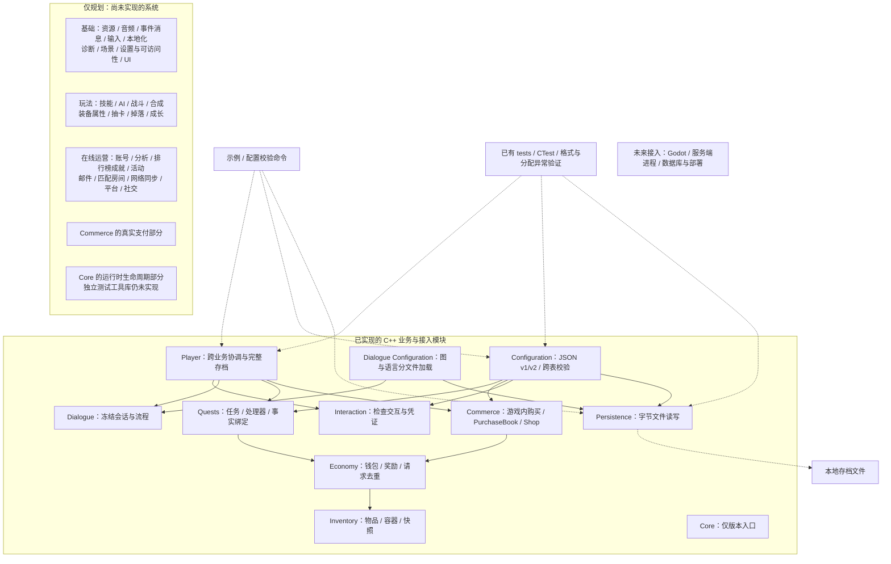

# 当前模块的架构分析与演进路线

日期：2026-10-24。性质：基于当前 CMake、公开接口与设计记录的架构分析；不是新功能实现或并发验收。商品目录外置的实现与验证另见玩家步骤006，不宣称当前能够承载 MMO 负载。

## 为什么形成这个架构

学习目标是形成可靠、可复用的游戏业务规则。先用具体场景建立不变量，再按状态所有权和一致性划分模块，而非按网络服务拆分。当前是模块化 C++ 库，可在单机或可信服务端应用中组合。

- inventory 维护槽位合法、数量守恒、失败不改变状态。
- economy 统一钱包、容器与经济请求记录，保证扣款发奖一起成功。
- commerce 在经济能力之上校验商品与购买意图，不允许调用方直接决定价格。
- quests 维护冻结定义、进度、事实/事件、一次性领取规则。
- interaction 维护每玩家交互资格与成功凭证，dialogue 维护冻结会话图与命令历史。
- player 协调多个业务状态，避免每个系统持有不同钱包；它不是所有业务类的基类。
- configuration 解析并整体校验内容，不让领域逻辑读取 JSON 或文件。
- persistence 只保存字节，领域编码与内存恢复仍归各模块。
- core 当前只有版本入口，不是已完成运行时框架；测试能力主要在 tests，不是独立引擎模块。

配置定义内容，玩家状态记录运行事实，请求表达意图，凭证记录成功结果。这四类不能混在同一个可随意修改的结构中。

## 扩展点与边界

| 设计 | 当前价值 | 能扩什么 / 不能自动获得什么 |
| --- | --- | --- |
| 独立 C++/CMake 目标 | 规则可单测、适配不同引擎 | 不自动获得跨平台发布或服务端部署 |
| Catalog 与玩家状态分离 | 配置变更不随意污染运行数据 | 冻结定义需要配置/存档迁移策略 |
| ObjectiveHandler/Registry | 替换确定的数字进度算法 | 不自动支持分支、阶段、回退或任意复杂状态 |
| GameplayFact 与冻结绑定 | 玩法事实按类型/对象映射到目标 | 事实来源真实性与可靠投递仍由业务接入层负责 |
| PurchaseBook 的准备接口 | Shop/Player 复用购买规则 | 不代表所有系统都应继承同一个事务基类 |
| Player 候选阶段 | 领奖与资产共享提交 | 不能撤销候选阶段已经发送的网络消息或数据库写入 |
| 请求 ID 与回执 | 同意图重试不重复执行，异意图冲突 | 不替代任务已领取、库存、购买资格等业务约束 |
| Snapshot 与显式编码 | 隔离运行对象与文件结构 | 校验和不防伪造，版本号不等于自动迁移 |

## 当前妥协

整状态深复制易验证异常安全，但成本随配置、容器和历史增长；未来先测量再考虑共享不可变配置、局部写集或持久化数据结构。共享配置需版本绑定和生命周期保证，不能原地热改。

Player 集中管理一致性，未来可能变成过大的协调器。以命令和真实事务边界分解，不让 AI、渲染等高频状态自动进入经济事务。quests 的具体 Player 友元及 Player 返回 quests::Error 是有限耦合，先保留，出现第二个协调场景再评估内部准备接口和高层错误类型。

PlayerSnapshot 沿用 commerce 快照并嵌套经济、容器格式，是复用和历史兼容的折中；逻辑上唯一经济状态不属于商城。后续多业务增长时可评估显式玩家分段格式，需版本迁移而非修改结构后沿用版本。

完整事件重建用于内部一致性校验，历史有界且满后拒绝新事件/请求，不能长期无限运行。经济回执不是完整审计流水，任务事件重建也不是整个游戏的事件溯源架构。长期方案需定义检查点、重试窗口、归档和审计保留策略。

事实观察与外部资产变更尚未自动统一：发物品成功后事件投递失败，需业务源可靠重试或扩大同一事务边界。不能直接靠生成新事件 ID 重试，否则可能重复推进。

配置包严格且单文件，便于起步；当前已支持 schema v1/v2/v3、事实绑定、交互配置及独立对话/文本加载，尚无完整编辑工作流、原子在线整包切换或通用迁移工具。

## 高并发演进建议（均非当前已实现）

先定义目标：在线人数、峰值业务命令每秒、单玩家突发、同场景人数、延迟分位数、内存和写入预算、故障后可接受丢失范围。连接数、业务吞吐、同场景模拟负载不是一个指标。

### 同一玩家串行，不同玩家并行

引入按玩家 ID 路由的有界命令队列/Actor 式调度。同一玩家所有写入和相关读取由同一所有者处理，多个玩家分布到线程/进程；不直接让多个线程共享调用当前 Player。跨进程需确保唯一有效所有者，迁移/故障接管用租约及所有权代次等机制拒绝旧写者。异步等待不能无意引入命令交错；不要为了等待磁盘而允许后续命令操作未确认状态。

序列化调度只是一条建议路径，不要求引入 Orleans、特定语言或框架。参考 [Orleans 调度说明](https://learn.microsoft.com/en-us/dotnet/orleans/grains/request-scheduling) 对单线程与请求交错的区别。

### 持久化成功之后再确认资产操作

当前 pointer swap 仅提交内存。新服务端持久化边界应统一包含资产、业务状态、请求去重记录及必要待投递消息。可选择数据库事务或经验证的持久化日志，明确崩溃后恢复和重试路径，不直接承诺 exactly-once。

数据库冲突必须处理，例如版本比较更新、唯一约束或合适的锁/隔离级别，并按策略重试完整事务。参考 [PostgreSQL 事务隔离](https://www.postgresql.org/docs/current/transaction-iso.html)。数据库产品尚未选定。

### 多玩家和共享世界

A 给 B 物品、多人抢限量库存、共享宝箱不属于单玩家原子性。根据一致性要求选择同数据库事务、集中交易所有者、预留/托管与可补偿协议。Saga 不是免费获得强原子性。世界模拟、聊天、分析等按不同负载组织，不默认每个库都是一个微服务。

### 限流、监控与恢复

有界队列、背压、请求限流、超时重试预算、批量写入和异步查询视图；测量候选复制耗时、队列长度、尾延迟、锁冲突、去重命中、存储错误和历史增长。测试重复、乱序、双会话、提交前后崩溃、回包丢失和恢复重复投递。

## 自己设计时的步骤

1. 选一个端到端用例，例如购买一份商品，而非先列一堆管理器。
2. 写不变量：不负余额、不丢物品、一次性奖励不重复，明确权威来源。
3. 列数据及唯一写入所有者，区分配置、状态、意图和凭证。
4. 列正常、失败、重试、重启与配置变更后的语义。
5. 确定哪些状态必须一起成功，由此划分模块与协调边界。
6. 做单进程最小实现，以边界、模型与故障注入验证。
7. 用第二个真实场景寻找共同规则，再抽象扩展点。
8. 定义负载与故障目标，测量瓶颈；引入调度、持久化与分片。
9. 记录选择、替代方案、验证结果与未来触发重构的条件。

## 当前架构图

实线箭头为已实现目标的源码/构建依赖，虚线为应用使用关系。待开发框内仅列能力范围，不表达已实现依赖或部署服务。

configuration 虽位于 foundation 目录，实际是上层内容适配器，并非所有领域共同依赖的底座。core 不存在通往所有业务的隐式依赖。文件格式、Snapshot 与领域恢复仍由各模块维护，玩家层只是统一组织。

以上是当前依赖结构，不是未来服务器拓扑。高并发部署建议另按状态所有者、访问频率和一致性要求设计，不能从目录数量推导服务器数量。

## 分析依据与验证范围

依据当前 CMake、docs/architecture.md、各模块 README/开发记录和公开 Player/任务接口。仅新增说明文档；未运行编译、压测或重新认证历史测试。待开发列表与 docs/systems-development.md 对照。同步新主工程后，交互与对话已有实现，且原短接口已采用动作与业务对象命名；当前归属以详细图为准。

## 详细图解

[成员、规则与函数交互图](architecture-details.md) 提供类持有关系及购买、任务、领奖和存档调用流程。

## 商品配置所有权修订

Player::products_已移除，商品配置由应用持有并以purchase_product(const ProductCatalog&, request)借用；同玩家可使用不同版本目录，新购买按当前传入配置结算，旧请求仍先查历史。Player保留interactions_和dialogues_，并在State内独立保存两个Book。上图已补全交互、对话及独立资源加载，目录职责不再依据旧工作树推断。
